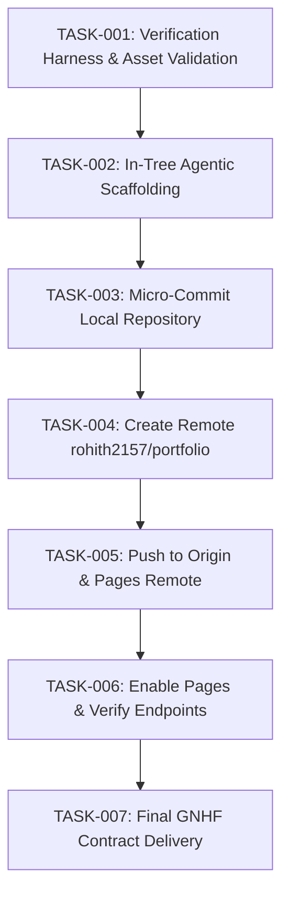

# Task Graph Specification (`GRAPH_SPEC.md`)

Use this document to define the sequential dependency graph for portfolio deployment.

## 1. Graph Overview (Mermaid)

## 2. Concurrency and Isolation Rules
- Step execution is sequential for deployment safety.
- Asset integrity is verified before remote creation and push.
- Remotes must use authenticated credential helper (`gh.exe`).

## 3. Node Specifications

### Node: `TASK-001`
- **Objective**: Create `verify.ps1` and validate core portfolio files.
- **Status**: PASSED.

### Node: `TASK-002`
- **Objective**: Scaffold in-tree Agentic Engineering files.
- **Status**: IN PROGRESS.

### Node: `TASK-003`
- **Objective**: Execute micro-commit for portfolio update.
- **Verification**: `git status` clean working tree.

### Node: `TASK-004`
- **Objective**: Create public repository `rohith2157/portfolio` via GitHub CLI.
- **Verification**: `gh repo view rohith2157/portfolio`.

### Node: `TASK-005`
- **Objective**: Push `main` branch to both `rohith2157/portfolio` and `rohith2157/rohith2157.github.io`.
- **Verification**: `git log` matches remote heads.

### Node: `TASK-006`
- **Objective**: Configure and verify GitHub Pages endpoints.
- **Verification**: GitHub API confirms Pages build status.
