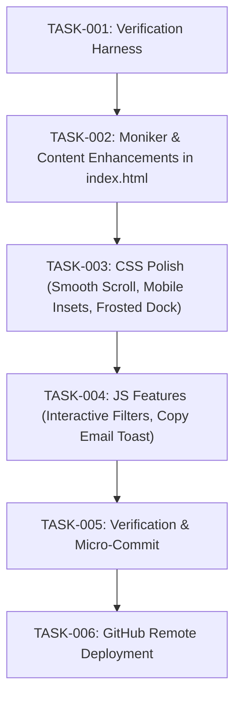

# Task Graph Specification (`GRAPH_SPEC.md`)

## Node Specifications
- **TASK-001**: Verification harness setup (`verify.ps1`).
- **TASK-002**: Update moniker to "Rooo" and add section features in `index.html`.
- **TASK-003**: Enhance `style.css` for mobile, scroll easing, and visual cards.
- **TASK-004**: Add project filters and interactive clipboard helper in `main.js`.
- **TASK-005**: Execute verification test and verify exit code 0.
- **TASK-006**: Micro-commit and push to `rohithprofile-remote` and mirror remotes.
